  

  
  
  
  
  
  

---

# 🎨 Awesome Web Vector Graphics Editor

A comprehensively curated directory and architectural index of modern **Web Vector Graphics Editors**, **Browser-Native SVG Design Platforms**, **Procedural 2D Node Engines**, and **Embeddable Canvas Toolkits**.

From zero-install web vector design applications to self-hosted, open-source Figma alternatives powered by **WebAssembly (Wasm)** and **WebGPU**, this repository tracks tools that create, manipulate, and export clean, standards-compliant vector artwork directly inside the browser.

> **Keywords**: *Web Vector Graphics Editor, SVG Editor Online, Browser-Based Vector Design, Open-Source Figma Alternative, Procedural 2D Vector Engine, WebAssembly Vector Drawing, Self-Hosted Design Platform, Canvas Vector Editor, Node-Based Vector Graphics, Embeddable SVG Canvas.*

---

## 📑 Table of Contents

- [📊 Sector Overview & Market Dynamics](#-sector-overview--market-dynamics)
- [☁️ SaaS & Hosted Platforms](#️-saas--hosted-platforms)
- [💻 Open-Source GitHub Projects](#-open-source-github-projects)
  - [Top Open-Source Vector Editors](#top-open-source-vector-editors)
  - [Open-Source Feature & Architecture Comparison](#open-source-feature--architecture-comparison)
- [🧩 Embeddable Vector Engines & Developer Libraries](#-embeddable-vector-engines--developer-libraries)
- [🤝 How to Contribute](#-how-to-contribute)
- [📈 Star History](#-star-history)
- [💖 Support & Sponsoring](#-support--sponsoring)
- [⚖️ Disclaimer & License](#️-disclaimer--license)

---

## 📊 Sector Overview & Market Dynamics

The global digital vector graphics and UI/UX design software market is currently valued at approximately **$4.2 billion in 2025** and is projected to expand to **$8.9 billion by 2030**, exhibiting a compound annual growth rate (**CAGR**) of **16.2%**. The transition from legacy monolithic desktop software (such as classic Adobe Illustrator and CorelDRAW) toward high-performance, browser-executable web applications has accelerated with the widespread browser adoption of **WebAssembly (Wasm)**, **WebGPU**, and real-time multiplayer CRDTs.

From a competitive standpoint, the sector is characterized by a **concentrated, winner-take-most dynamic at the enterprise collaboration tier** (where Figma and Canva capture the vast majority of commercial teams and enterprise visual assets), coupled with a **moderately fragmented and rapidly innovating long-tail** of specialized, privacy-first, self-hostable open-source solutions (such as **Penpot** and **Graphite**). This open-source segment is driven by organizations seeking zero vendor lock-in, data sovereignty, embeddable component architectures, and procedural node-driven graphics pipelines.

---

## ☁️ SaaS & Hosted Platforms

The table below catalogs premier commercial and hosted Web Vector Graphics Editors, ranked in descending order by **Company Scale (Valuation / Annual Revenue)**. Specific starting prices and detailed free tier boundaries are enumerated below.

| 🏢 Platform | 💰 Company Scale (Valuation / Revenue) | 🏷️ Starting Tier Pricing | 🎁 Free Tier / Free Trial Limits | ⚡ Core Vector Capabilities & Focus |
| :--- | :--- | :--- | :--- | :--- |
| **[Adobe Illustrator Web / Adobe Express](https://www.adobe.com/products/illustrator.html)** | **Valuation: ~$210B (Market Cap)** Annual Revenue: ~$21.5B ARR | **$9.99/month** (Express Premium) or **$22.99/month** (Illustrator Single App) | **Free Forever Plan**: 25 generative AI credits/month, 5GB cloud storage, thousands of templates, Adobe Stock assets, and fundamental vector editing tools. | Industrial-grade vector pathing, pen tool precision, SVG/EPS export, and Creative Cloud asset synchronization directly in Chromium browsers. |
| **[Canva](https://www.canva.com/)** | **Valuation: ~$26B** Annual Revenue: ~$2.3B+ ARR | **$12.99/month** per user (or **$120.00/year** billed annually for Canva Pro) | **Free Forever Plan**: 5GB cloud storage, 1M+ free photos and graphics, 250,000+ free templates. *(Note: High-res SVG vector export is restricted to Pro; free exports limited to PNG, JPG, and standard PDF)*. | Template-first visual editor with drag-and-drop vector assets, team collaboration, brand kits, and automated social-media asset generation. |
| **[Figma](https://www.figma.com/)** | **Valuation: ~$12.5B** Annual Revenue: ~$750M ARR | **$12.00/editor/month** (billed annually) or **$15.00/month** (billed monthly for Professional) | **Free Forever "Starter" Plan**: 3 active collaborative Figma design files, 3 FigJam boards, unlimited personal drafts, 1 team project, and 30-day version history. | The industry-standard browser vector canvas with real-time multiplayer, vector networks, auto-layout, design tokens, component variants, and interactive prototyping. |
| **[Corel Vector (Alludo)](https://www.vector.com/)** | **Valuation: Backed by KKR ($500B+ AUM)** Alludo Division Revenue: ~$150M+ ARR | **$99.99/year** (~$8.33/month equivalent, billed annually for Corel Vector Pro) | **15-Day Free Trial**: Fully featured 15-day trial with complete vector editing toolset, 500MB cloud sync, and SVG/PDF export. *(No permanent free plan; reverts to view-only mode after trial expiry)*. | Full-fledged vector illustration suite (formerly Gravit Designer) featuring non-destructive boolean operations, multiple borders/fills per object, and CMYK/RGB precision output. |
| **[Kittl](https://www.kittl.com/)** | **Valuation: ~$100M+** Total Funding: $36M+ Series B | **$10.00/month** (billed annually at $120/year) or **$15.00/month** (monthly Pro plan) | **Free Forever Plan**: Standard-resolution PNG/JPG exports, personal use license only, 20 AI credits, 500MB cloud storage, and public artwork showcase. | Advanced browser typography, vector lettering manipulation, non-destructive warping, dynamic shading, and AI-powered vector generation. |
| **[Linearity Curve](https://www.linearity.io/curve/)** | **Valuation: ~$50M+** Total Funding: $20M+ Series A | **$9.99/month** (billed annually at $119.88/year) or **$14.99/month** (monthly Pro plan) | **Free Forever "Starter" Plan**: 3 active documents, 30 export files/month, standard pen and brush vectors, and 1GB cloud storage. | Precision vector design tool (formerly Vectornator) with AI auto-trace from raster to vector, responsive canvas layout, and stylus-optimized curve editing. |
| **[Vectr](https://vectr.com/)** | **Scale: Inmagine Group** Parent Revenue: ~$50M+ ARR | **$3.99/month** or **$39.99/year** (Vectr Premium) | **Free Forever Plan**: Ad-supported workspace, 30MB cloud storage, up to 10 project saves, and standard web-resolution SVG/PNG exports. | Lightweight, accessible browser vector drawing tool built for rapid iconography, simple diagrams, and introductory vector design. |
| **[Boxy SVG](https://boxy-svg.com/)** | **Scale: Independent Developer** Revenue: ~$500K ARR (Bootstrapped) | **$9.99/year** (Web App Subscription) or **$19.99 one-time** (macOS / Windows App Store) | **Free Forever Web Demo**: Unlimited in-browser vector creation and manual local file save/export with no login required. *(14-day free trial provided for cloud storage sync and offline PWA assets)*. | Clean SVG-first editor that directly mirrors the SVG DOM. Preserves IDs, CSS classes, defs, and metadata without polluting output files with proprietary metadata. |

---

## 💻 Open-Source GitHub Projects

This section showcases premier open-source web vector graphics editors and SVG creation software. Sorted in **descending order by GitHub star count**, each entry features a live social badge linking directly to the project's stargazers community.

### Top Open-Source Vector Editors

#### 1. 🌟 [Penpot](https://penpot.app/) — `penpot/penpot`

- **License**: MPL-2.0
- **Primary Stack**: Clojure, ClojureScript, WebAssembly, SVG/Canvas rendering
- **Description**: The premier open-source design and prototyping platform built for cross-functional teams. Penpot is natively built around open web standards (SVG, CSS Grid, Flexbox), ensuring that designs translate directly into production-ready code without vendor lock-in.
- **Key Features**: Multi-user real-time collaboration, native design tokens, component systems, CSS Flex/Grid layout engines, Model Context Protocol (MCP) server support for AI agents, and enterprise self-hosting via Docker and Kubernetes.

#### 2. ✏️ [tldraw](https://tldraw.dev/) — `tldraw/tldraw`

- **License**: Custom / tldraw SDK Community License (Free for non-commercial & standard use)
- **Primary Stack**: TypeScript, React, HTML5 Canvas/SVG
- **Description**: An extraordinarily flexible, infinite canvas vector engine and whiteboard SDK. Powers seamless collaborative vector drawing, freehand path smoothing, procedural geometric shapes, and instant SVG/PNG exports.
- **Key Features**: Frictionless multiplayer sync engine, plug-and-play React SDK components, customizable vector tools, shape binding, and programmatic canvas APIs.

#### 3. 🦀 [Graphite](https://graphite.rs/) — `GraphiteEditor/Graphite`

- **License**: Dual MIT / Apache-2.0
- **Primary Stack**: Rust, WebAssembly, WebGPU (`wgpu`)
- **Description**: A breakthrough procedural 2D graphics suite that blends traditional vector illustration with a node-based procedural compositing engine (Graphene). The entire pipeline executes locally in your browser at GPU speeds.
- **Key Features**: Non-destructive node graph architecture, Rust-compiled WebAssembly runtime, GPU-accelerated rendering, sub-pixel vector mathematics, and an ambitious roadmap targeting desktop publishing and motion graphics.

#### 4. 📐 [Draw.io / diagrams.net](https://app.diagrams.net/) — `jgraph/drawio`

- **License**: Apache-2.0
- **Primary Stack**: JavaScript, mxGraph, SVG, XML
- **Description**: The battle-tested web diagramming and vector drawing suite used by millions globally. Runs completely client-side in the browser with zero cloud storage dependencies unless explicitly configured.
- **Key Features**: Extensive vector shape libraries, clean SVG/XML export, custom path manipulation, offline execution, and integrations with GitHub, GitLab, Google Drive, and Nextcloud.

#### 5. 🛠️ [SVG-Edit](https://svgedit.netlify.app/editor/index.html) — `SVG-Edit/svgedit`

- **License**: MIT
- **Primary Stack**: JavaScript (ES6 Modules), HTML5 SVG Canvas
- **Description**: The veteran browser-based SVG vector editor that paved the way for web-based vector drawing. Completely re-engineered in version 7 into a modern modular architecture.
- **Key Features**: Separated into `@svgedit/svgcanvas` (headless core engine) and UI layer, embeddable in any web application with a simple `
` container, and native extension APIs.

#### 6. 🔍 [VTracer](https://www.visioncortex.org/vtracer-docs/) — `visioncortex/vtracer`

- **License**: AGPL-3.0
- **Primary Stack**: Rust, WebAssembly
- **Description**: An open-source, high-fidelity raster-to-vector (SVG) conversion engine that runs entirely in the browser via WebAssembly. Converts bitmap sketches, logos, and photos into geometric vector paths.
- **Key Features**: High-precision bezier curve fitting, progressive color clustering, zero server processing, and real-time client-side interactive parameter tuning.

#### 7. ⚡ [SVGOMG](https://jakearchibald.github.io/svgomg/) — `jakearchibald/svgomg`

- **License**: Apache-2.0
- **Primary Stack**: JavaScript, Service Workers, SVGO
- **Description**: The gold-standard web GUI for SVG vector optimization. Allows vector artists and developers to strip redundant metadata, round numeric precision, and optimize path commands interactively.
- **Key Features**: Side-by-side visual diffing, instant gzip/brotli size preview, precision sliders, offline PWA support, and markup inspection.

#### 8. 📍 [SVG Path Editor](https://yqnn.github.io/svg-path-editor/) — `Yqnn/svg-path-editor`

- **License**: MIT
- **Primary Stack**: TypeScript, SVG DOM
- **Description**: A specialized web-based visual editor designed specifically for creating, analyzing, and manipulating raw SVG `<path>` data strings (`d="..."`).
- **Key Features**: Visual node handles for cubic and quadratic Bézier curves, path scaling, coordinate rounding, command conversion (absolute vs. relative), and live path string serialization.

#### 9. 🎨 [Method Draw](https://editor.method.ac/) — `methodofaction/Method-Draw`

- **License**: MIT
- **Primary Stack**: JavaScript, Canvas, SVG
- **Description**: A minimalist, distraction-free browser vector editor originally forked from SVG-Edit. Intentionally streamlined by removing complex layer trees and obscure settings in favor of immediate usability.
- **Key Features**: Intuitive pen and shape tools, clean color picker, zero tracking or account mandates, and instantaneous SVG/PNG downloads.

#### 10. ⚙️ [Maker.js](https://maker.js.org/) — `microsoft/maker.js`

- **License**: Apache-2.0
- **Primary Stack**: TypeScript, Node.js, Web SVG
- **Description**: Microsoft's open-source parametric 2D vector drawing and modeling engine for the web. Enables programmatic construction of geometric vectors for CNC machining, laser cutters, and SVG artwork.
- **Key Features**: Parametric modeling, curve filleting, boolean path intersections, SVG/DXF export, and interactive web playground.

#### 11. 🖼️ [Mondrian](https://github.com/artursapek/mondrian) — `artursapek/mondrian`

- **License**: MIT
- **Primary Stack**: CoffeeScript, JavaScript, HTML5 Canvas
- **Description**: An elegant, open-source web-based vector drawing application designed with modular tools for lines, curves, rectangles, and circular vectors.
- **Key Features**: Clean geometric drawing canvas, local storage persistence, undo/redo state stacks, and standalone client-side SVG exports.

---

### Open-Source Feature & Architecture Comparison

| 📦 Repository | ⭐ GitHub Stars | 📜 License | 🏗️ Technology Architecture | 🐳 Self-Hostable (Docker) | 🎯 Best Used For |
| :--- | :--- | :--- | :--- | :---: | :--- |
| **[Penpot](https://github.com/penpot/penpot)** | ~61.5k+ | MPL-2.0 | ClojureScript + Wasm + SVG | Yes (Official Docker/K8s) | Collaborative UI/UX design & Figma replacement |
| **[tldraw](https://github.com/tldraw/tldraw)** | ~51.0k+ | Custom / Free | TypeScript + React + Canvas | Yes (Embeddable SDK) | Infinite whiteboard & interactive vector SDK |
| **[Graphite](https://github.com/GraphiteEditor/Graphite)** | ~27.7k+ | MIT / Apache-2.0 | Rust + Wasm + WebGPU | Yes (Static Web / Docker) | Non-destructive procedural 2D illustration |
| **[Draw.io](https://github.com/jgraph/drawio)** | ~8.9k+ | Apache-2.0 | JavaScript + mxGraph + SVG | Yes (Official Docker Image) | Technical diagrams, schematics & flowcharts |
| **[SVG-Edit](https://github.com/SVG-Edit/svgedit)** | ~7.8k+ | MIT | Vanilla JS (ES6) + SVG DOM | Yes (Static HTML/JS) | Embeddable in-app SVG drawing component |
| **[VTracer](https://github.com/visioncortex/vtracer)** | ~7.3k+ | AGPL-3.0 | Rust + WebAssembly | Yes (Static Wasm) | High-fidelity raster-to-SVG vectorization |
| **[SVGOMG](https://github.com/jakearchibald/svgomg)** | ~6.2k+ | Apache-2.0 | JavaScript + SVGO + PWA | Yes (Static Web / Node) | Automated SVG file compression and cleanup |
| **[SVG Path Editor](https://github.com/Yqnn/svg-path-editor)** | ~5.3k+ | MIT | TypeScript + SVG DOM | Yes (Static Web) | Precision Bézier curve and path string editing |
| **[Method Draw](https://github.com/methodofaction/Method-Draw)** | ~3.0k+ | MIT | JavaScript + Canvas | Yes (Static Web) | Quick, lightweight vector sketches without bloat |
| **[Maker.js](https://github.com/microsoft/maker.js)** | ~2.0k+ | Apache-2.0 | TypeScript + Geometric Math | Yes (NPM Package / Web) | Programmatic CAD and 2D laser-cut SVG design |
| **[Mondrian](https://github.com/artursapek/mondrian)** | ~1.2k+ | MIT | CoffeeScript / JavaScript | Yes (Static Web) | Clean geometric vector art experiments |

---

## 🧩 Embeddable Vector Engines & Developer Libraries

If you are an engineer seeking to embed vector manipulation directly into your own web application rather than deploying a standalone design tool:

- **[Fabric.js](https://github.com/fabricjs/fabric.js)** (`~31.5k stars`) — Battle-tested HTML5 canvas library with interactive vector object models, SVG parsing, and bi-directional serialization.
- **[Rough.js](https://github.com/rough-stuff/rough)** (`~21.3k stars`) — Renders graphics in a charming hand-drawn, sketchy vector aesthetic with native SVG and Canvas output.
- **[Paper.js](https://github.com/paperjs/paper.js)** (`~15.1k stars`) — The Swiss Army Knife of vector graphics scripting on HTML5 Canvas, providing Bézier mathematics and path manipulation.
- **[SVG.js](https://github.com/svgdotjs/svg.js)** (`~11.8k stars`) — Lightweight, ultra-fast JavaScript library for manipulating, animating, and binding events to SVG elements.

---

## 🤝 How to Contribute

Contributions are wholeheartedly welcomed! To add or update an entry:

1. **Fork the repository** to your own GitHub account.
2. **Edit `README.md`** following the existing tabular structure, ensuring:
   - Tool name and official URL link.
   - Specific starting tier pricing and explicit free tier or free trial limits.
   - Company scale (valuation/revenue) or GitHub repository link with live star badge.
3. **Verify Markdown formatting** and ensure all links are functioning.
4. **Submit a Pull Request** with a concise description of your changes.

For the parent collection of curated lists, explore [Awesome Awesome Awesome](https://github.com/ishandutta2007/Awesome-Awesome-Awesome).

---

## 📈 Star History

---

## 💖 Support & Sponsoring

A sincere thank you to all the contributors, stargazers, and open-source advocates who make this index possible! 🌟

If this curated repository saved you time or aided your technical evaluation:
- ⭐ **Star this repository** to improve visibility across the developer community.
- 🍴 **Fork and contribute** to keep entries, feature matrices, and pricing up to date.
- 📢 **Share** with colleagues, designers, and frontend engineers.
- ☕ **Support the maintainer**: If you would like to support continuous curation and open-source maintenance, please consider buying a coffee or contributing via the [GitHub Sponsor Dashboard](https://github.com/sponsors/ishandutta2007)!

---

## ⚖️ Disclaimer & License

- This is a community-curated research compilation and does not constitute formal commercial endorsement.
- All product names, logos, and brands are property of their respective owners.
- Released under the [MIT License](LICENSE). Made with ❤️ for the global web design and developer community.
